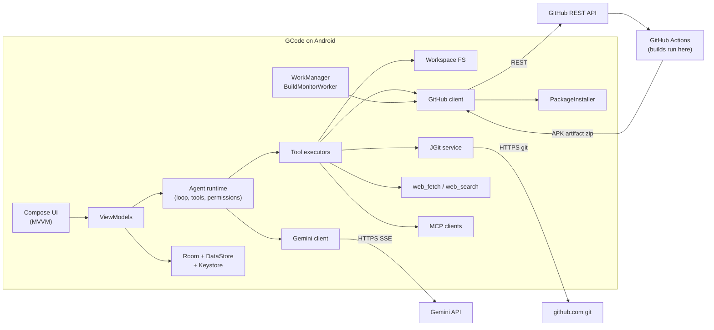
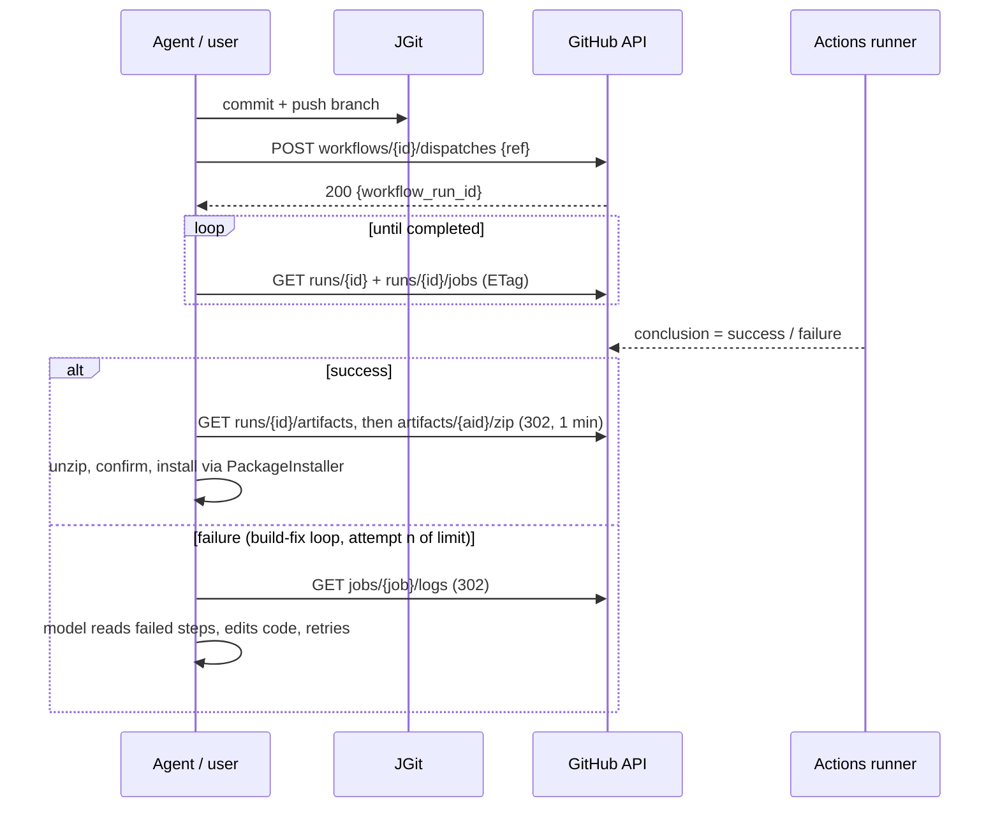

# GCode — Architecture

GCode is a native Android app that works as an agentic coding assistant on the
phone. The user talks to an agent backed by the Google Gemini API (their own
key). The agent reads and edits code in a local Git workspace, commits and
pushes with JGit, and drives GitHub (repos, PRs, issues, releases, Actions).

**Core rule: the phone never compiles code or builds APKs.** All builds run on
GitHub Actions. The app pushes, starts a workflow, monitors it, reads the
logs, downloads the APK artifact and installs it.

This is an original implementation. It borrows the general *workflow* of
terminal coding agents, but no source code from Anthropic or anyone else.

> Status: **draft for approval** (2026-11-27). Section 2 lists the decisions I
> need from you before Phase 1 starts.

---

## 1. Verified facts this design relies on

Checked on 2026-11-27 against primary sources (Google Maven, Maven Central,
`services.gradle.org`, `dl.google.com/android/repository`, the Gemini API
docs, which now live at `aistudio.google.com/docs` (`ai.google.dev` redirects
there), `docs.github.com`, and `modelcontextprotocol.io`). Exact version pins
are finalised in Phase 1 in `gradle/libs.versions.toml` after a real build.

### 1.1 Toolchain and libraries

| Item | Version (latest stable seen) | Note |
|---|---|---|
| Gradle | 9.9.2 | wrapper committed |
| Android Gradle Plugin | 9.5.3 | 9.6 is still alpha |
| Kotlin | 2.4.21 | 2.5.0 is RC; AGP 9 has built-in Kotlin support |
| KSP | 2.3.14 | for Hilt and Room |
| compileSdk / targetSdk | compileSdk **37.2**, targetSdk **37** (Android 17) | Compose 1.13 requires compileSdk 37.1 or newer; build-tools 37.0.0 |
| Navigation | Navigation 3 1.2.2 | back stack as a list of serializable keys |
| Licences screen | AboutLibraries 15.3.0 | generates the dependency list and licence texts at build time |
| minSdk | 26 | as requested |
| Compose BOM | 2026.11.01 | Material 3, Material 3 Adaptive |
| Hilt | 2.60.1 (androidx.hilt 1.4.0) | |
| Room / WorkManager / DataStore | 2.8.5 / 2.12.0 / 1.3.0 | |
| OkHttp (+ okhttp-sse, mockwebserver3) | 5.5.1 | single HTTP stack |
| Retrofit | 3.0.0 | GitHub REST interface |
| kotlinx.serialization / coroutines | 1.13.0 / 1.11.0 | |
| JGit | **5.13.5.202508271544-r** | 7.x targets Java 17 and calls JDK APIs missing on API 26–32; 5.13 (Java 8) is used. See risk R1 and DECISIONS.md #17 |
| Sora Editor | 0.24.7 (`editor-bom`, `language-textmate`) | **LGPL-2.1**. See decision D4 |
| BouncyCastle `bcprov-jdk18on` | 1.87 | sealed box for GitHub secrets, on-device keystore generation |
| Jsoup | 1.24.1 | `web_fetch` HTML to text |
| Markdown (Compose M3) | `multiplatform-markdown-renderer-m3` 0.46.0 | chat rendering |
| Tests | JUnit 4.13.2, MockK 1.14.12, Turbine 1.2.1, Truth 1.4.5, Robolectric 4.18.1 | |

### 1.2 Gemini API

* Base URL `https://generativelanguage.googleapis.com/v1beta`, auth header
  `x-goog-api-key`.
* `GET /models` (Model fields: `name`, `baseModelId`, `version`,
  `displayName`, `inputTokenLimit`, `outputTokenLimit`,
  `supportedGenerationMethods`, `thinking`, `temperature`, ...).
* `POST /models/{model}:streamGenerateContent?alt=sse` (SSE `data:` lines),
  `:generateContent`, `:countTokens` (body `{"contents": [...]}`).
* **`gemini-4-hydrogen` exists.** It went GA on 2026-11-12. The other
  Gemini 4 models are `gemini-4-carbon`, `gemini-4-neon` and `gemini-4-argon`
  (all have a 1M-token context). The newest Flash is `gemini-3.8-flash`. The
  newest Flash-Lite is `gemini-3.5-flash-lite`. `gemini-2.5-flash` and
  `gemini-2.5-pro` are deprecated and get rerouted on 2026-12-01. Fallback
  logic is computed from `models.list`, never hard-coded (section 5.2).
* Function calling: `tools[].functionDeclarations[]` with an OpenAPI-style
  `parameters` schema. The model returns `functionCall {name, args, id}`
  parts. Results go back as `functionResponse {name, response, id}` parts in a
  `role: "user"` turn, with the `id` echoed and **in the same order** as the
  calls. Parallel calls arrive as several `functionCall` parts in one turn.
* **Thought signatures:** Gemini 3 and 4 put a `thoughtSignature` on the first
  `functionCall` part of every step. It must be sent back **in the exact part
  where it was received**. Parts that carry a signature must never be merged.
  Leaving one out gives HTTP 400. When streaming, a signature can arrive on
  an empty text part. Section 5.4 covers how GCode handles this.
* Thinking: `generationConfig.thinkingConfig.thinkingLevel`
  (`minimal|low|medium|high|xhigh`, which levels a model accepts varies by
  model). `thinkingBudget` exists only for 2.5 models and must never be sent
  together with `thinkingLevel` (that returns HTTP 400). `includeThoughts`
  is boolean. Gemini 4 models cannot turn thinking off.
* Google Search grounding: a `google_search` tool. Gemini 3 and 4 can combine
  built-in tools with function declarations, but that combination is still in
  preview.
* Rate limits: HTTP 429 `RESOURCE_EXHAUSTED`, counted per project
  (RPM/TPM/RPD; RPD resets at midnight Pacific). Grounded search is free for
  the first 5,000 requests per month, then paid.
* New AI Studio keys (since 2026-05-28) are "auth keys" and must be
  restricted to "Gemini API only". Onboarding will tell the user this.
* **The docs now present a newer "Interactions API"** (`POST /v1beta/interactions`)
  as the recommended interface (GA since June 2026). They call
  `generateContent` "legacy" but say it "remains fully supported", with no
  shutdown date. See decision D1.

### 1.3 GitHub

* REST API versions: **`2026-03-10`** (latest) and `2022-11-28` (supported
  until 2028-03-10). GCode sends `X-GitHub-Api-Version: 2026-03-10`.
  Breaking changes in that version that GCode depends on:
  * The workflow-dispatch call now **always returns `200` with
    `workflow_run_id`, `run_url` and `html_url`**, so a build can be tracked
    exactly from the moment it is triggered.
  * The issue `assignee` field was removed; use `assignees`.
  * `merge_commit_sha` was removed from PR payloads.
  * Submodules in directory listings now have `type: "submodule"`.
* Device flow: `POST github.com/login/device/code` (`client_id`, `scope`),
  then poll `POST github.com/login/oauth/access_token` with
  `grant_type=urn:ietf:params:oauth:grant-type:device_code`. Errors to handle:
  `authorization_pending`, `slow_down` (+5 s to the interval),
  `expired_token`/`token_expired`, `access_denied`, `device_flow_disabled`,
  `incorrect_device_code`. No client secret is needed. Device flow must be
  enabled in the app's settings on GitHub.
* Artifact zip and job logs both answer with a `302` to a URL that **expires
  after 1 minute**. Follow the redirect at once, and never send the GitHub
  token to the redirect host (OkHttp drops `Authorization` on a cross-host
  redirect).
* Secrets: `GET /actions/secrets/public-key` returns a base64 `key` and a
  `key_id`. `PUT /actions/secrets/{name}` takes `encrypted_value` and
  `key_id`. The value is encrypted with a libsodium `crypto_box_seal`.
* OAuth scopes: `repo`, `workflow` (needed to write `.github/workflows/*`),
  `read:org`, `delete_repo`.
* Fine-grained PAT permissions: `contents`, `workflows`, `actions`,
  `pull_requests`, `issues`, `administration`, **`secrets`**, `metadata`.
  Your list was missing **Issues** and **Secrets**; GCode needs both for the
  issue features and for setting signing secrets. A fine-grained PAT can only
  reach **one** owner (your user, or one organization), and organizations can
  hold a token pending approval.

### 1.4 Other

* `androidx.security:security-crypto` (EncryptedSharedPreferences) is
  **deprecated**: "Deprecated all APIs in favour of existing platform APIs and
  direct use of Android Keystore." GCode uses Android Keystore directly
  (section 9).
* MCP: the current spec revision is **2026-07-28**. Streamable HTTP clients
  send `Accept: application/json, text/event-stream`, plus the
  `MCP-Protocol-Version`, `Mcp-Method` and `Mcp-Name` headers. Protocol-level
  sessions (`Mcp-Session-Id`) were **removed** in this revision; revisions
  2025-03-26 through 2025-11-25 still use them. GCode negotiates the version
  with each server.

---

## 2. Decisions I need from you

| # | Decision | My recommendation |
|---|---|---|
| **D1** | Gemini interface: `generateContent` (stable schema, labelled "legacy", fully supported) or the new Interactions API (recommended by Google for new projects; its docs still disagree with each other on some field shapes). | **`generateContent` behind a `GeminiTransport` interface.** GCode keeps all history on the device anyway, because rewind, compaction, sub-agents and secret filtering all need it. So the main advantage of Interactions, server-side state, does not apply, and stateless Interactions (`store=false`) gives no extra features here. `generateContent` documents thought signatures and function calling clearly for REST, and neither API can be tested live from CI without a key. An Interactions transport can be added later without touching the agent code. |
| **D2** | GitHub sign-in: a GitHub **OAuth App** (scopes) or a **GitHub App** (fine-grained permissions). | **OAuth App + device flow**, with PAT (fine-grained or classic) as the fallback. A GitHub App's token reaches only repositories where the app is *installed*, and its tokens expire every 8 hours. That breaks "open any repo / fork any repo". **You must register an OAuth App** (Settings → Developer settings → OAuth Apps), tick *Enable Device Flow*, and give me the **Client ID**. A client ID is not a secret; it goes in a repository *variable* `GCODE_GITHUB_CLIENT_ID` and can be overridden in the app's settings. Scopes requested at sign-in: `repo workflow read:org`. `delete_repo` is requested only the first time you delete a repo. |
| **D3** | Branching. This session may only push to `ccr-ee862235-7b5f5g`, and the repo has no `main` yet. | You allow me to create **`main`** from the approved docs commit, and you set it as the default branch (pushing first makes `ccr-…` the default on an empty repo). Each phase is developed on `ccr-ee862235-7b5f5g` and lands as **one PR into `main`**. After a merge I restart that branch from `main`. |
| **D4** | Sora Editor is LGPL-2.1. | Fine if GCode is open source, or if you are happy to comply with LGPL (ship its source and notice, allow relinking). If you want no LGPL code, I would build a simpler Compose editor with Compose text APIs and a TextMate-free highlighter. That costs about one extra phase of work. |
| **D5** | Instrumented UI smoke test in CI needs an emulator job (about 6–10 min). | Run it on PRs and on `main` only, not on every branch push. |

---

## 3. System overview



### 3.1 Build loop (no compilation on the phone)



---

## 4. Module layout

Logic lives in **pure Kotlin/JVM modules**, so it can be unit-tested fast
without Android. Android-specific code sits only in `:app` and `:core:data`.

```
:app                      Android application: Compose UI, navigation, Hilt wiring,
                          AgentService (foreground), WorkManager workers,
                          PackageInstaller, voice input, notifications
:core:model       (JVM)   shared data types (ids, repo refs, run status, permission types)
:core:common      (JVM)   Result/err types, dispatchers, glob/ignore matching, text utils
:core:data        (AAR)   Room DB, DAOs, DataStore settings, Keystore-backed SecretStore
:gemini           (JVM)   Gemini REST client, SSE parser, model catalog + fallback,
                          retry/backoff, token accounting
:github           (JVM)   GitHub REST client (Retrofit), device flow, pagination,
                          rate-limit handling, sealed box, log parser, workflow templates
:git              (JVM)   JGit wrapper: clone/fetch/pull/push/status/diff/commit/
                          branch/merge/log, conflict model
:agent            (JVM)   agent loop, tool registry + all tool implementations,
                          permission policy, checkpoints, compaction, todo,
                          sub-agents, slash commands, GEMINI.md loader, build-fix guard
:mcp              (JVM)   MCP client over streamable HTTP
```

Rules for dependencies between modules:

* `:agent` sees `:gemini`, `:github`, `:git` and `:mcp` only through
  interfaces it owns (`ChatModel`, `GitHubGateway`, `GitGateway`,
  `ApkInstaller`, `UserPrompter`, ...). That keeps the agent testable with
  fakes.
* No JVM module depends on Android. `:app` binds the Android
  implementations with Hilt.
* `javax.inject` annotations in the JVM modules let Hilt build their classes
  without a dependency on Android.

### 4.1 Layers inside `:app`

`Screen (Compose)` → `ViewModel (StateFlow<UiState>, one-off events)` →
`UseCase / Repository` → data sources (`:core:data`, `:github`, `:git`, `:gemini`).
The UI never calls a network or Git API directly.

---

## 5. Gemini model layer (`:gemini`)

### 5.1 Client

* OkHttp 5 + kotlinx.serialization. One `GeminiClient` exposes:
  `listModels()`, `streamGenerate(request): Flow<StreamEvent>`,
  `generate(request)`, `countTokens(model, contents)`.
* The SSE parser is hand-written and line-based (`data:` frames, keep-alives,
  `[DONE]` tolerated). It is cancellable: cancelling the coroutine closes the
  call.
* Unknown JSON fields are ignored (`ignoreUnknownKeys`), but **each part is
  also kept as raw JSON**, so `thoughtSignature` and any future fields survive
  the round trip unchanged.
* The API key is added by an interceptor from `SecretStore`. Logging redacts
  `x-goog-api-key`.

### 5.2 Model discovery and fallback

1. `models.list` runs after the key is entered, every 24 h, and on manual
   refresh. All pages are followed (`nextPageToken`). The result is cached in
   Room with a timestamp.
2. The **picker shows every model** whose `supportedGenerationMethods`
   contains `generateContent`. It groups them by family and shows the
   context size and thinking support.
3. **Agent-capable** models are the subset whose IDs do not end in a
   media-only suffix (`-tts`, `-image`, `-live`, `-transcribe`, embeddings,
   etc).
4. Choosing the active model:
   * The preferred model is the user's choice (default `gemini-4-hydrogen`).
   * If it is missing from the list, or returns 403/404 or a quota with
     `limit: 0` on first use, it is marked *unavailable for this key* for 24 h.
   * Then pick the **newest Flash**: parse `gemini-<version>-flash[-preview…]`,
     sort by numeric version descending, stable before preview. Today that is
     `gemini-3.8-flash`.
   * Then the **newest Flash-Lite**, the same way. Today that is
     `gemini-3.5-flash-lite`.
   * The top bar always shows the model that is actually active. A chip
     appears when a fallback is in use.
5. Pure function `ModelSelector.select(catalog, prefs, health)`, unit-tested
   against recorded `models.list` fixtures.

### 5.3 Thinking level

* `thinking == true` in the catalog shows the control. GCode keeps a small
  table of the levels each known model accepts (from the docs, e.g.
  Hydrogen: `low|medium|high|xhigh`, 3.8 Flash: `low|medium|high`).
  Unknown models get "Default" plus `low|medium|high`.
* If a level is rejected with a 400, GCode drops it to the model's default,
  remembers that, and retries once.
* 2.5 models get `thinkingBudget` instead. GCode never sends both.

### 5.4 Thought signatures and streaming aggregation

* Streamed chunks are folded into one model `Content`:
  * Consecutive plain text parts **without** a signature are concatenated.
  * A part that carries `thoughtSignature` stays a separate part, exactly as
    received (this includes an empty text part).
  * `functionCall` parts are kept whole, with their `id`.
  * Thought parts (`thought: true`) are kept for the UI and sent back as they
    came.
* The folded `Content` is saved verbatim in Room (`parts_json`) **before** any
  tool runs. A crash or restart therefore never loses a signature.
* Every `functionCall` gets a `functionResponse`, even when it was denied,
  failed, or cancelled by Stop. That keeps the history valid for the next
  request.

### 5.5 Rate limits (429 / `RESOURCE_EXHAUSTED`)

* Exponential backoff with full jitter: 1 s base, factor 2, 32 s cap, up to 5
  tries. If the error carries `google.rpc.RetryInfo.retryDelay`, that value is
  used. The UI shows "Rate limited, retrying in N s".
* **Auto-switch toggle (off by default):** when the retries are used up, the
  model is put on a cool-down (default 10 min), and GCode moves to the next
  model in the fallback chain that is available and not cooling down. A
  snackbar says so. The Gemini API does not say which models are free for a
  given key, so "next free model" means *the next model that is available to
  this key and not currently rate-limited*.
* Unit-tested with a virtual clock.

### 5.6 Tokens and compaction

* Each response's `usageMetadata` (`promptTokenCount`,
  `candidatesTokenCount`, `thoughtsTokenCount`, `totalTokenCount`) is stored
  per message.
* Context gauge = last `promptTokenCount` + an estimate for new content,
  divided by the model's `inputTokenLimit`. When the estimate crosses 70%,
  GCode calls `countTokens` on the pending request for an exact number.
* **Auto-compact at 80%**, and with the manual "Compact" action or
  `/compact`:
  * Runs only at a turn boundary, never in the middle of a function-call
    step, because signatures in the current step must be kept.
  * A non-streaming `generateContent` call summarises the older turns
    (goals, decisions, files touched, open todos, build state). History
    becomes: summary + the last *K* turns.
  * The original messages stay in Room (marked compacted), so the UI and
    Rewind still have them.

---

## 6. Agent runtime (`:agent`)

### 6.1 Loop

```
runTurn(userInput):
  history += user(userInput, attachments)
  repeat until done | cancelled | stepLimit:
    budget.ensure()                       // may auto-compact
    req = build(system = basePrompt + GEMINI.md + mode rules + todo,
                history, tools = registry.forMode(mode), config)
    model = gemini.stream(req)            // UI shows streaming text/thoughts
    history += model                      // saved verbatim
    calls = model.functionCalls
    if calls.isEmpty(): done
    results = executor.run(calls)         // permissions, parallel groups, checkpoints
    history += user(functionResponses(results, sameOrder, idsEchoed))
```

* **Stop** cancels the coroutine scope. The open stream is closed; tools that
  are running get cooperative cancellation; every unanswered call gets a
  `{"error":"cancelled by user"}` response.
* The step limit (default 50 model calls per turn) pauses and asks
  "Continue?".
* A foreground `AgentService` (with an ongoing notification and a Stop
  action) keeps a turn alive when the app is in the background. The right
  foreground-service type for API 37 is confirmed in Phase 4.

### 6.2 Parallel tool execution

Each tool declares an `Effect`:

* `READ` (files, Git read, GitHub read, web)
* `WORKSPACE_WRITE`
* `GIT_LOCAL`
* `REMOTE` (push, GitHub changes)
* `DANGEROUS` (the always-confirm set)

Within one model turn:

* Contiguous `READ` calls run **concurrently** (at most 4 at a time).
* Calls with any other effect run **one after another, in order**. Approval
  prompts are shown one at a time.
* Results are put back in the original call order.

### 6.3 Todo list, sub-agents, build-fix loop

* `todo_write` replaces the session's todo list (items have `content` and a
  status: `pending`, `in_progress` or `done`). The list is shown pinned above
  the chat and is added to the system prompt every turn.
* `task(description, prompt, subagent_type?)` starts a **child loop** with
  its own history, the tool set allowed for that agent type (read-only by
  default), the parent's permission mode, and a step limit. Only the child's
  final summary goes back to the parent as the tool result. The UI shows a
  collapsible card for the child's work.
* **Build-fix guard:** for each session and repo, GCode counts the builds
  triggered after a failed build. When the count reaches the user's limit
  (default 3, set per repo), `gh_trigger_workflow` and pushes stop, and the
  agent is told to report back. The tools themselves are plain
  (`gh_wait_for_run` suspends until the run ends or a timeout). The *loop* is
  the model's behaviour, guided by the system prompt and bounded by the
  guard.

### 6.4 Tool catalog (all declared to Gemini as functions)

| Group | Tools | Effect |
|---|---|---|
| Files | `read_file` (offset/limit), `list_dir`, `glob`, `grep` | READ |
| | `write_file`, `edit_file` (exact match, must be unique unless `replace_all`), `multi_edit` (all edits or none), `delete_file`, `move_file` | WORKSPACE_WRITE |
| Git | `git_status`, `git_diff`, `git_log` | READ |
| | `git_add`, `git_commit`, `git_branch` (create/list/delete*), `git_checkout`, `git_merge`*, `git_pull` | GIT_LOCAL |
| | `git_push` (force*) | REMOTE |
| GitHub repos | `gh_list_repos`, `gh_search_repos`, `gh_get_file` | READ |
| | `gh_create_repo`, `gh_fork_repo` | REMOTE |
| | `gh_clone_repo` | WORKSPACE_WRITE |
| Collaboration | `gh_list_prs`, `gh_list_issues` | READ |
| | `gh_create_pr`, `gh_comment`, `gh_create_issue` | REMOTE |
| | `gh_merge_pr` (into default branch*) | REMOTE |
| Actions | `gh_get_run_status`, `gh_wait_for_run`, `gh_get_run_logs`, `gh_list_artifacts` | READ |
| | `gh_setup_build_workflow`, `gh_trigger_workflow`, `gh_create_release` | REMOTE |
| | `gh_download_apk` | WORKSPACE_WRITE (app storage) |
| | `gh_install_apk` | DANGEROUS (always confirm) |
| Web | `web_fetch` (Jsoup to text, size cap), `web_search` (a separate `generateContent` call with only `google_search`; returns the answer and its sources) | READ |
| Other | `todo_write`, `task`, `submit_plan` (Plan mode only) | none |
| MCP | `mcp__<server>__<tool>` | REMOTE, unless the server marks the tool `readOnlyHint` |

`*` These operations are always confirmed (section 7.2).

* Tool output is capped: 30k characters by default. Longer output is
  truncated with a note, and the full text can be read again with
  offset/limit.
* `gh_get_run_logs` returns the failed steps with about 200 lines of context
  each, not the whole log.
* `web_search` makes its own request so that it works on every model,
  including models where combining built-in tools with functions is still
  in preview.
* In Plan mode, Gemini sees only the READ tools plus `submit_plan`. This
  also saves tokens.

---

## 7. Permissions and safety

### 7.1 Modes

| Effect | Ask | Auto-accept edits | Plan | Full auto |
|---|---|---|---|---|
| READ | allow | allow | allow | allow |
| WORKSPACE_WRITE | **diff sheet** | allow | hidden | allow |
| GIT_LOCAL | ask | ask | hidden | allow |
| REMOTE | ask | ask | hidden | allow |
| DANGEROUS | **confirm** | **confirm** | hidden | **confirm** |
| Sending a denylisted or ignored file to the model | **confirm** | **confirm** | **confirm** | **confirm** |

* **Full auto** needs an explicit opt-in screen with a warning. It can be
  enabled per session or per repo, never globally by default.
* **Plan mode:** the agent explores with read-only tools and calls
  `submit_plan(markdown)`. The user approves the plan and picks a mode to
  carry it out, or rejects it with feedback.
* `PermissionPolicy.decide(tool, args, mode, repoContext): Allow | Ask |
  Confirm | Deny` is a **pure function**. It has exhaustive unit tests for
  every tool × mode, plus the special cases below.

### 7.2 Always confirm, in every mode

Delete a repo or branch, force push, merge into the default branch (local
`git_merge` or `gh_merge_pr`), make a repo public, create or change secrets,
install an APK. Each one opens a dedicated dialog that names the target
(for example "Delete branch `feature/x` on `owner/repo`"). Full auto cannot
skip it.

### 7.3 Diff sheet (Ask mode)

`edit_file`, `write_file` and `multi_edit` compute the proposed content
first, then show a unified diff in a bottom sheet with **Accept / Reject /
Edit**. Edit opens the proposal in the editor; the version the user saves is
written to disk, and the model is told "user modified your change" along
with the final diff. Reject returns a denial with the user's optional
comment.

### 7.4 Secret protection

* Default denylist (globs, editable in settings): `.env`, `.env.*`, `*.jks`,
  `*.keystore`, `*.p12`, `*.pem`, `*.key`, `local.properties`,
  `keystore.properties`, `id_rsa*`, `*.p8`, `credentials*.json`.
* Files that are git-ignored (checked through JGit's ignore rules) are
  treated the same way.
* `read_file` on such a file asks for confirmation. `grep` and `glob` skip
  them and say how many were skipped. File attachments are checked too.
* Tokens and keys never appear in logs, crash reports or tool results.
  Logging goes through a redacting tree.

### 7.5 Checkpoints and Rewind

* Before every workspace change, GCode saves a checkpoint: the session,
  the message index, the path, and the file's previous bytes (or "did not
  exist"). Bytes go in `filesDir/checkpoints/<session>/`, metadata in Room.
* **Rewind** to any user message offers three choices: restore code,
  restore conversation, or both. Files are restored in reverse order.
* Remote actions (push, PR, release) cannot be undone. Rewind lists the ones
  done after the chosen point and warns about them.
* Checkpoints are pruned per session (keep the last 100, or 50 MB).

### 7.6 Workspace sandboxing

All file tools resolve paths inside the active repo root. `..` and symlinks
that point outside the root are rejected (unit-tested). The agent cannot
read app-private files such as databases or key stores.

---

## 8. GitHub integration (`:github`, `:git`)

### 8.1 Authentication

* **Device flow** (decision D2). The UI shows the `user_code` with Copy and
  "Open github.com/login/device". Polling respects `interval` and
  `slow_down`; the code expires after 15 min.
* **PAT fallback.** Fine-grained tokens (`github_pat_`) and classic tokens
  (`ghp_`) are both accepted. GCode checks the token with `GET /user`, reads
  the classic scopes from `X-OAuth-Scopes`, and shows a checklist of what is
  missing.
* Tokens are stored in `SecretStore` (section 9).
* A `401` sends the user to re-authentication. A missing scope (403 with
  `X-Accepted-OAuth-Scopes`) starts an incremental re-authorisation, for
  example to add `delete_repo`.

### 8.2 REST client

* Base `https://api.github.com`. Headers: `Accept:
  application/vnd.github+json`, `X-GitHub-Api-Version: 2026-03-10`,
  `Authorization: Bearer …`, `User-Agent: GCode-Android`.
* Pagination follows the `Link` header (`Flow<Page<T>>`).
* Conditional requests use `ETag`/`If-None-Match`. A 304 does not count
  against the rate limit, which matters for status polling.
* Primary and secondary rate limits: read `x-ratelimit-*`, honour
  `retry-after`, back off.
* Uploads (release assets) go to `uploads.github.com`.

Endpoints by feature:

| Feature | Endpoints |
|---|---|
| Account | `GET /user`, `GET /user/orgs` |
| Repos | `GET /user/repos?affiliation=owner,collaborator,organization_member`, `GET /orgs/{org}/repos`, `GET /search/repositories`, `POST /user/repos`, `POST /orgs/{org}/repos`, `GET /gitignore/templates`, `GET /licenses`, `POST /repos/{o}/{r}/forks`, `PATCH /repos/{o}/{r}` (visibility*), `DELETE /repos/{o}/{r}`* |
| Files | `GET /repos/{o}/{r}/contents/{path}?ref=`, `PUT …/contents/{path}` (one-file commit without a clone) |
| Branches | `GET …/branches`, `DELETE …/git/refs/heads/{b}`* |
| PRs | `GET/POST …/pulls`, `GET …/pulls/{n}`, `GET …/pulls/{n}/files`, `PUT …/pulls/{n}/merge`, `GET/POST …/issues/{n}/comments` |
| Issues | `GET/POST …/issues`, `GET …/issues/{n}`, `POST …/issues/{n}/comments` |
| Actions | `GET …/actions/workflows`, `POST …/workflows/{id}/dispatches` (200 + `workflow_run_id`), `GET …/actions/runs?head_sha=&branch=&event=`, `GET …/runs/{id}`, `GET …/runs/{id}/jobs`, `GET …/jobs/{id}/logs` (302), `GET …/runs/{id}/artifacts`, `GET …/artifacts/{id}/zip` (302), `POST …/runs/{id}/cancel`, `POST …/runs/{id}/rerun-failed-jobs` |
| Releases | `GET/POST …/releases`, `POST uploads.github.com/…/releases/{id}/assets?name=` |
| Secrets | `GET …/actions/secrets`, `GET …/actions/secrets/public-key`, `PUT …/actions/secrets/{name}`* |

`*` always confirmed.

### 8.3 Local Git (JGit)

* Workspace: `filesDir/workspace/<owner>/<repo>`. This is app-private
  storage; exporting through the Storage Access Framework is possible later.
* HTTPS auth: `UsernamePasswordCredentialsProvider("x-access-token", token)`.
  No SSH, so the JGit SSH modules are not included.
* Operations: clone (progress shown in the UI, optional single-branch clone; JGit 5.13 has no shallow clone),
  fetch, pull (merge or rebase, set per repo), push (force uses
  `--force-with-lease` semantics through the expected old object id), status,
  diff (`DiffFormatter`, word-level highlighting in the UI), add/reset,
  commit, branch create/switch/delete/list, merge, log with per-commit diffs.
* Commit author: the GitHub name and
  `<id>+<login>@users.noreply.github.com`. The user can change it per repo.
* **Conflicts:** `MergeResult` conflicts are turned into a per-file model
  (base/ours/theirs hunks). The resolver shows each hunk with *Ours / Theirs
  / Both / Edit / Ask AI*. Ask AI sends only the conflicting hunks plus
  context (the denylist still applies) and shows the suggestion as a diff to
  accept.
* All JGit calls run on `Dispatchers.IO` behind `GitGateway`.

### 8.4 Remote build pipeline

* **Detection:** a repo is an Android project if it has `settings.gradle(.kts)`
  and an `com.android.application` plugin. Existing workflows come from
  `GET …/actions/workflows`.
* **"Set up builds"** adds `.github/workflows/build.yml` from a versioned
  template in `:github` and commits it:
  * triggers: `push`, `pull_request` and `workflow_dispatch`
  * JDK setup and Gradle caching
  * `./gradlew assembleDebug`
  * uploads `**/build/outputs/apk/debug/*.apk` as artifact `app-debug-apk`
  * optional signed release job on `v*` tags, run when signing secrets exist

  The template's action versions are pinned and checked in Phase 6.
* **Stable debug signing (optional):** each CI run otherwise makes a fresh
  debug key, so a new APK cannot update the previous install. GCode can
  generate a PKCS#12 debug keystore on the device (BouncyCastle) and store it
  as the secret `DEBUG_KEYSTORE_BASE64` (sealed box; always confirmed). The
  template uses it when present. GCode's own CI does the same.
* **Build button:** commit (asks for a message, or the agent proposes one) →
  push → dispatch on that branch → open the live run.
  * If the workflow runs on `push` and has no `workflow_dispatch`, GCode
    finds the run with `GET …/runs?head_sha=<sha>`.
  * Duplicate runs are avoided: if a push already started a run for that
    SHA, no dispatch is sent.
* **Live status:** poll `runs/{id}` and `runs/{id}/jobs` every 5 s while the
  screen is open (ETag). Shows queued / in progress / success / failure, per
  job and per step, with timings.
* **Logs:** job logs are downloaded as plain text (302, 1-minute URL) and
  parsed into steps (`##[group]` markers, timestamps). Failed steps are
  expanded and highlighted; `##[error]` lines are marked. Logs are cached per
  job.
* **Artifacts → install:**
  * List the run's artifacts, download the zip (with progress) into
    `filesDir/builds/<owner>/<repo>/<runId>/`, extract the `.apk`, check that
    it parses (`PackageManager.getPackageArchiveInfo`).
  * Confirmation dialog (package, version, size).
  * A `PackageInstaller` session streams the file in.
    `STATUS_PENDING_USER_ACTION` launches the system prompt. If GCode is not
    yet allowed to install, the user is sent to
    `ACTION_MANAGE_UNKNOWN_APP_SOURCES`.
  * A signature mismatch (`INSTALL_FAILED_UPDATE_INCOMPATIBLE`) is explained,
    and GCode offers uninstall-then-install or stable debug signing.
* **Build history:** Room table `builds` (repo, run id, branch, SHA, status,
  conclusion, times, artifact id, local APK path). APKs can be downloaded
  again until GitHub's artifact retention runs out, which shows as HTTP 410.
* **Releases:** create a tag and release (`POST …/releases` with
  `target_commitish`), upload the APK asset, list releases.
* **Secrets:** a guided screen links to `github.com/<o>/<r>/settings/secrets/actions`,
  or sets the secrets through the API (public key → sealed box → PUT; always
  confirmed). The sealed box is built from BouncyCastle X25519, XSalsa20-Poly1305
  and BLAKE2b (nonce = BLAKE2b-24(ephemeral_pk ‖ recipient_pk)). Unit tests
  check it against libsodium test vectors and round trips.
* **Background monitoring:** `BuildMonitorWorker` (unique per run id).
  * A `CoroutineWorker` that polls with ETag every 20–30 s.
  * Runs as a long-running foreground worker while the run is active, and
    re-enqueues itself if it is stopped.
  * When the run ends: notification "Build succeeded – Install" or "Build
    failed – View logs". `POST_NOTIFICATIONS` is requested on Android 13+.
* **Non-Android projects:** any workflow can be listed, dispatched (with
  inputs from the workflow's `workflow_dispatch.inputs`), monitored and have
  its logs read. Artifacts can be downloaded and shared.

---

## 9. Persistence and security

* **SecretStore:**
  * An AES-256-GCM key in the **Android Keystore** (non-exportable;
    StrongBox when the phone has it).
  * Ciphertext (12-byte IV + data) is kept in a dedicated DataStore file.
  * Holds the Gemini key, the GitHub token and MCP auth headers.
  * No plain text ever touches disk. `android:allowBackup` excludes this
    store, the workspace and the databases (data-extraction rules).
* **DataStore (Preferences):** global settings (theme, language, default
  mode, preferred model, thinking level, auto-switch, compaction threshold,
  denylist, GitHub client ID override).
* **Room** (`gcode.db`, schema exported, migrations tested):

| Entity | Key columns |
|---|---|
| `sessions` | id, title, repoId?, branch, mode, model, createdAt, updatedAt, todoJson, compactedUpTo |
| `messages` | id, sessionId, seq, role, partsJson (verbatim), usageJson, compacted, createdAt |
| `tool_calls` | id, messageId, callId, name, argsJson, status, resultJson, durationMs |
| `checkpoints` | id, sessionId, messageSeq, path, blobPath?, existed |
| `models` | name, displayName, inputTokenLimit, outputTokenLimit, methods, thinking, fetchedAt |
| `remote_repos` | fullName, private, defaultBranch, description, pushedAt, fork, fetchedAt |
| `local_repos` | id, fullName, path, defaultBranch, buildWorkflow, autoFixLimit, pullMode, author |
| `builds` | id, repoFullName, runId, workflowId, branch, headSha, status, conclusion, artifactId, apkPath, createdAt |
| `mcp_servers` | id, name, url, enabled, headerKeys (values in SecretStore) |

* **Network:** HTTPS only (`cleartextTrafficPermitted=false`). Release builds
  shrink and obfuscate with R8, with keep rules for kotlinx.serialization,
  JGit and BouncyCastle.

---

## 10. Project memory and configuration

* **GEMINI.md:** loaded in this order, each with a size cap:
  1. global user memory (from settings)
  2. `<repo>/GEMINI.md`
  3. `<repo>/.gcode/GEMINI.md`
  4. `GEMINI.md` files in sub-directories the agent has read from

  They are added to the system prompt. **Init** (`/init`) runs a read-only
  sub-agent that surveys the repo (build files, modules, CI, conventions)
  and proposes a `GEMINI.md`, which goes through the normal diff approval.
* **Per-repo settings:** default branch, build workflow file, auto-fix limit
  (default 3), pull mode, commit author, default permission mode.

---

## 11. Extensibility

* **Custom slash commands:** `.gcode/commands/*.md` in the repo, plus global
  commands in the app. `/name some args` expands the file, replacing
  `$ARGUMENTS` with `some args`. Optional frontmatter: `description`, `model`,
  `mode`. Built-in commands: `/init`, `/compact`, `/clear`, `/model`, `/mode`,
  `/rewind`, `/build`, `/todos`, `/help`.
* **Custom sub-agents:** `.gcode/agents/*.md`. YAML frontmatter has `name`,
  `description`, `tools` (an allow-list) and an optional `model`; the body is
  the system prompt. These appear as `subagent_type` values in the `task`
  tool.
* **MCP client (`:mcp`):**
  * Streamable HTTP over OkHttp: `initialize` (version negotiation, preferring
    2026-07-28), `tools/list`, `tools/call`.
  * Required headers are sent. `Mcp-Session-Id` is used only with servers on
    revisions older than 2026-07-28. Both JSON and SSE responses are
    accepted.
  * Server tools are namespaced `mcp__<server>__<tool>` and go through the
    same permission policy.
  * Servers are configured in Settings (URL plus optional auth header stored
    in SecretStore).
  * In Phase 9 I will check whether the official Kotlin SDK (0.16.0) supports
    2026-07-28 without pulling Ktor into the app. If not, GCode keeps its own
    small client, which only needs the tools capability.

---

## 12. UI

Navigation uses Material 3 Adaptive `NavigationSuiteScaffold`: a bottom bar
on phones, a rail on tablets, with a Navigation 3 back stack. There are five
top-level destinations: **Chat, Repos, Code, Builds, More**. Files and source
control share **Code** (as tabs), because both belong to the open repository;
this keeps the bottom bar at five items. **More** holds PRs, Issues,
Releases, Sessions, Settings, Open-source licences and About.

1. **Onboarding:**
   * Gemini key (with the "restrict to Gemini API" tip), checked by calling
     `models.list`
   * GitHub device flow or PAT
   * workspace info and permissions (notifications, install unknown apps,
     asked when first needed)
2. **Repositories:** your repos, org repos, search, create (name,
   description, visibility, README, .gitignore template, license), clone
   (with progress), fork, delete the local copy.
3. **Agent chat:**
   * streaming Markdown with syntax-highlighted code blocks and a copy
     button
   * collapsible tool-call cards (arguments, result, duration, diff preview)
   * thought summaries (collapsed)
   * todo panel
   * **status bar:** model · mode · repo · branch · context %
   * image attachments (Photo Picker → `inlineData`, size-capped), voice
     input (`RecognizerIntent`, no microphone permission needed), slash
     command autocomplete, Stop button
4. **Files and editor:**
   * tree explorer (respects `.gitignore` styling)
   * Sora Editor in `AndroidView`, with tabs, find/replace, undo/redo,
     TextMate grammars (Kotlin, Java, XML, Gradle, JSON, YAML, Markdown and
     others)
   * the editor is always left-to-right, even in Arabic
5. **Source control** (a tab of Code): changes (stage/unstage per file), diff viewer (unified,
   or side by side on tablets), commit, push/pull/fetch, branches, history
   with per-commit diff, conflict resolver.
6. **Builds:** Build button, workflow picker, live run, step tree, log viewer
   (search, failed steps highlighted), artifacts, build history, download and
   install.
7. **PRs / Issues / Releases:** list, detail, create, comment, merge (merging
   into the default branch is always confirmed); releases with APK upload.
8. **Sessions, Settings, Model picker.**
9. **Open-source licences:** GCode's Apache-2.0 licence, the LGPL-2.1 notice
   and full text for Sora Editor, and every dependency with its licence
   (generated at build time by AboutLibraries, which also fails the build if
   a dependency brings a licence that is not on the reviewed allow-list).

On tablets, **two panes** (`ListDetailPaneScaffold`) put the chat next to the
file, diff or build panel. Light and dark themes, plus dynamic color on
Android 12+. **Arabic and RTL:** `supportsRtl`, start/end layout everywhere,
all strings in `values-ar/strings.xml`; code, diffs and logs are forced LTR.

---

## 13. Testing strategy

* **JVM unit tests** (the bulk; run in CI on every push):
  * **Tools:** `edit_file` uniqueness, `replace_all`, `multi_edit`
    all-or-nothing, glob/grep with ignore rules, path sandboxing, output
    truncation; Git tools on temporary JGit repos.
  * **Permission policy:** every tool × mode, the always-confirm set, and the
    denylist and ignore checks.
  * **Model selection and fallback:** catalog fixtures, unavailability,
    cool-downs, auto-switch, backoff with a virtual clock.
  * **Gemini client:** SSE parsing, chunk folding that keeps thought
    signatures, function-call round trip, 429 and `RetryInfo`; all through
    MockWebServer with recorded fixtures.
  * **GitHub client (mocked):** device-flow polling state machine (all error
    codes), pagination, ETag, dispatch 200 parsing, run/job/artifact parsing,
    302 artifact/log redirect without leaking the token, sealed box against
    vectors, log parser.
  * **Agent loop** with a scripted fake model: parallel READs, ordering,
    cancellation answers every call, step limit, build-fix guard,
    compaction at the boundary, checkpoints and rewind.
* **Android unit tests:** Robolectric for `SecretStore` contracts and Room
  DAOs/migrations.
* **Instrumented UI smoke test (one):** launches the app on an emulator,
  completes onboarding with fakes injected through a Hilt test module, opens
  chat, sends a prompt to a fake model, and sees the streamed reply and a
  tool card. Runs in CI on an emulator (decision D5).
* **Manual test checklist** for each phase (real key and token on a phone),
  in `docs/TESTING.md`.
* Optional **live smoke workflow** (manual dispatch only, never on PRs):
  uses repository secrets `GEMINI_API_KEY` and a test PAT if you add them.

---

## 14. CI/CD for GCode itself (`.github/workflows/android.yml`)

* **Triggers:** push (all branches), pull_request, tags `v*`,
  workflow_dispatch. Concurrency group per ref, cancel in progress.
* **Job `build`** (ubuntu, Temurin JDK 21):
  * Gradle setup with dependency and configuration caching
  * `./gradlew lint testDebugUnitTest assembleDebug`
  * upload artifact **`gcode-debug-apk`**
  * on failure, upload lint and test reports
* **Job `ui-test`:** emulator (KVM), `connectedDebugAndroidTest`. Runs on
  PRs and `main`.
* **Job `release`** (tags `v*` only, `permissions: contents: write`):
  * decode `KEYSTORE_BASE64` into `$RUNNER_TEMP`
  * `assembleRelease` signed with `KEYSTORE_PASSWORD`, `KEY_ALIAS` and
    `KEY_PASSWORD` (passed as environment variables to Gradle, never echoed)
  * create the GitHub Release with the APK using the preinstalled `gh` CLI,
    so no third-party release action is needed
* `GCODE_GITHUB_CLIENT_ID` is read from repository **variables** into
  `BuildConfig` (or from the `gcode.githubClientId` Gradle property locally).
  **The build fails with a clear message if it is missing.** It is never
  hard-coded.
* `THIRD_PARTY_NOTICES.md` is generated from the build's dependency metadata;
  CI fails if it is out of date.
* `docs/SIGNING.md` explains how to:
  * create the keystore with `keytool`
  * base64-encode it
  * add the four secrets (Settings → Secrets and variables → Actions, or
    `gh secret set`)
  * add the optional `DEBUG_KEYSTORE_BASE64`
* Third-party action versions are checked and pinned in Phase 1.
* **No secrets in the repo:** `.gitignore` covers `*.jks`, `*.keystore`,
  `local.properties`, `.env*` and `keystore.properties`. A CI step fails the
  build if a tracked file matches the denylist.

---

## 15. Risks and mitigations

| # | Risk | Mitigation |
|---|---|---|
| R1 | JGit 7.x targets Java 17. Some JDK APIs may be missing on ART at runtime. | **Resolved in Phase 3:** a static API check showed ~40 missing JDK methods for 7.x on API 26, so GCode uses JGit 5.13.5 (Java 8 API surface). An instrumented test runs clone/commit/push/pull/merge on API 26 and 36 emulators in CI. |
| R2 | Neither Gemini nor GitHub can be called live from CI (no keys). | Recorded fixtures, MockWebServer, a manual checklist, and the optional dispatch-only live smoke job. |
| R3 | Bugs in thought-signature handling cause 400s mid-task. | Parts stored verbatim, a folding algorithm with tests, and on a 400 that mentions `thought_signature`, a clear error plus "retry from last good step". |
| R4 | 50+ tool schemas cost tokens on every call. | Tool sets per mode; MCP tools only when enabled; later, Gemini's "tool retrieval" preview (Gemini 3.6+). |
| R5 | Organizations can block OAuth apps, and fine-grained PATs reach only one owner. | Clear errors that link to the org approval page; classic PAT as a last resort. |
| R6 | Android background limits on foreground services (Android 15+, 17). | Foreground service type confirmed on API 37 in Phase 4; WorkManager long-running workers for builds. |
| R7 | Google advises against keys in client apps. | The user enters their own key at runtime; it is Keystore-encrypted, restricted to the Gemini API, and never bundled. |
| R8 | The default model is not available on a free-tier key. | Automatic fallback chain with a visible chip in the top bar. |
| R9 | Large repos are slow on a phone. | Shallow clone option, cancellable operations, streaming progress, clear storage use per repo. |

---

## 16. Delivery process

* Ten phases, as listed in `TASKS.md`. Each phase is a series of small
  commits on the working branch and ends as **one PR into `main`**.
* **A phase is done only when CI is green.** If CI fails, I read the logs,
  fix, and push again.
* At the end of each phase I report what works, what is stubbed, and the
  Actions run link with the `gcode-debug-apk` artifact.
* Before pushing, I build and run the tests locally with an Android SDK in
  my container, so CI is the confirmation, not the first try.
* Never committed: API keys, tokens, keystores, `local.properties`.
