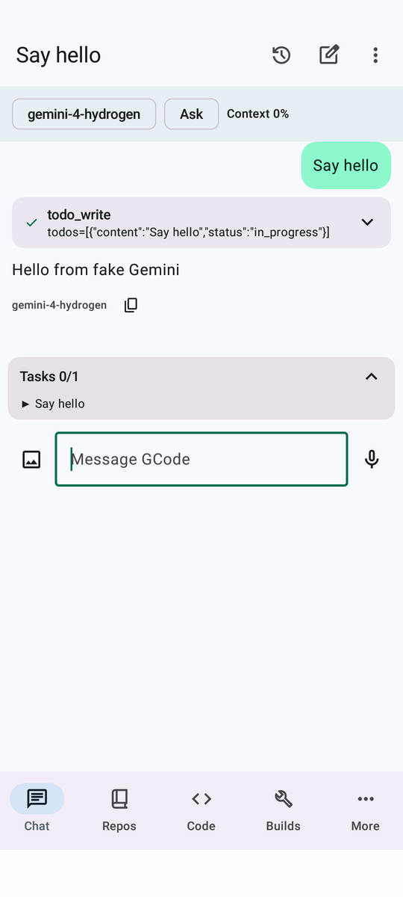
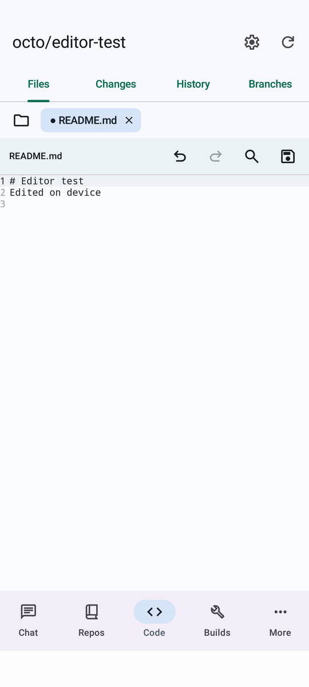
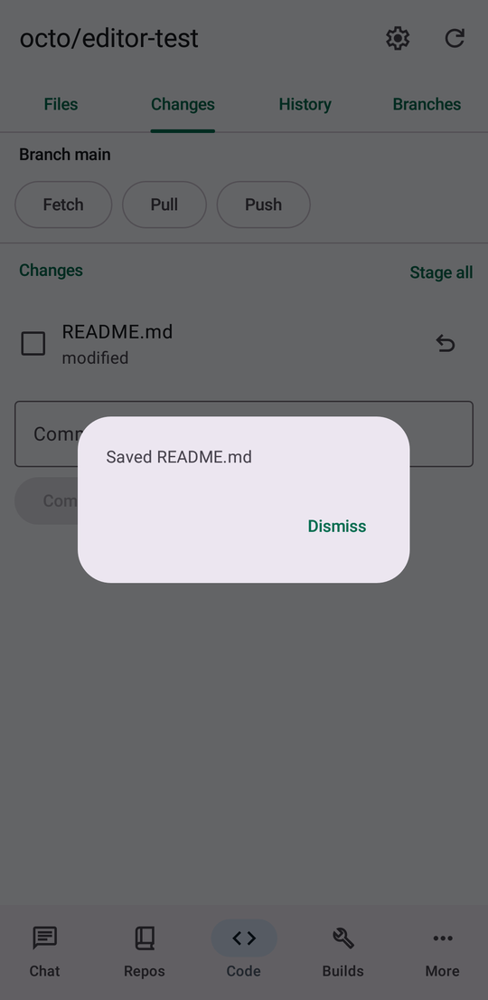
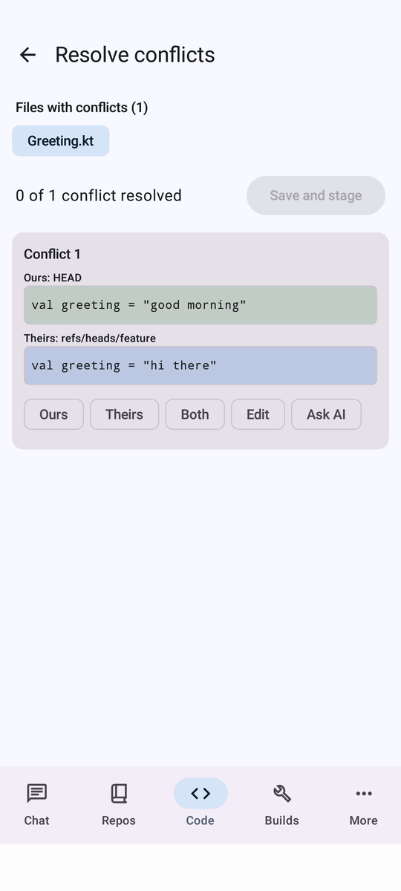
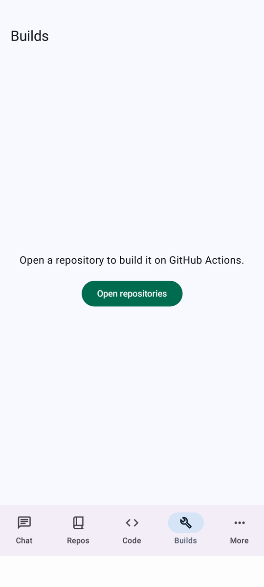
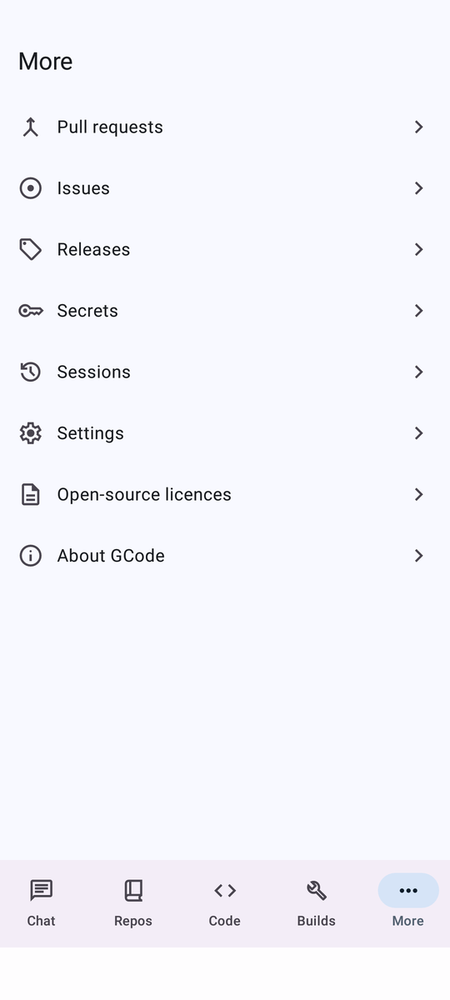
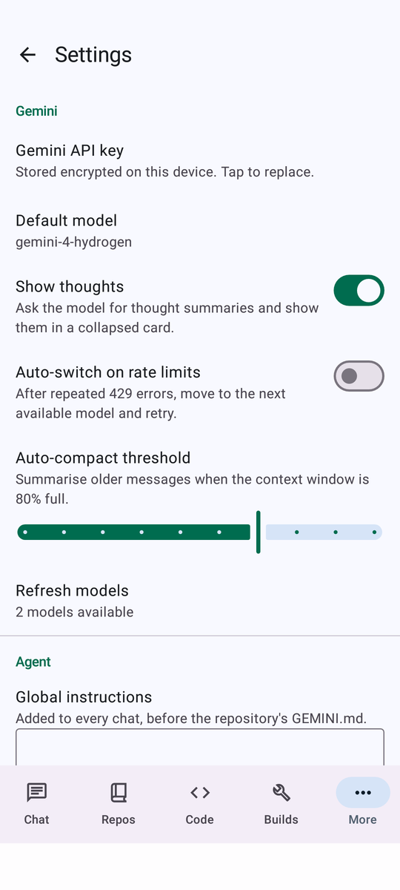

# GCode

GCode is a native Android app that works as an agentic coding assistant on your phone. You talk to
an agent backed by the **Google Gemini API** (your own key). It reads and edits code in a local Git
workspace, commits and pushes, and drives GitHub: repositories, pull requests, issues, releases and
GitHub Actions.

**The phone never compiles code.** Every build runs on GitHub Actions. GCode pushes, starts the
workflow, follows it live, reads the logs, downloads the APK artifact and installs it. When a build
fails, the agent can read the failed steps, fix the code and rebuild, up to a limit you set.

## Screenshots

Captured automatically by the instrumented tests on an Android emulator; the chat uses a scripted
Gemini fake.

| Chat with a tool card | Code editor | Changes | Merge conflict |
|---|---|---|---|
|  |  |  |  |

| Builds | More | Settings |
|---|---|---|
|  |  |  |

## Features

**Agent**
* Gemini with streaming, native function calling, thinking levels and thought summaries.
* Model discovery from `models.list` (24 h cache), default `gemini-4-hydrogen` with fallback to the
  newest Flash and Flash-Lite, a model picker, 429 backoff and optional auto-switch.
* Tool loop with parallel read-only calls, a live todo list, sub-agents (`task`), Stop at any time.
* About 50 tools:
  * files: read, write, edit, multi-edit, list, glob, grep, delete, move
  * Git: status, diff, add, commit, push, pull, branch, checkout, merge, log
  * GitHub: repos, PRs, issues, releases
  * Actions: set up a build workflow, trigger, wait, read logs, artifacts, download and install the APK
  * web: fetch and Google-grounded search
  * MCP server tools
* Token tracking with automatic compaction at 80% of the context (configurable), plus manual
  Compact.
* Memory: global instructions plus the repository's `GEMINI.md` (`/init` writes it). Slash commands
  from `.gcode/commands/`, custom sub-agents from `.gcode/agents/`.

**Safety**
* Modes: Ask, Auto-accept edits, Plan (read-only, propose a plan) and Full auto (explicit opt-in).
* **Always confirmed, in every mode:**
  * deleting a repository or branch
  * force push
  * merging into the default branch
  * making a repository public
  * changing secrets
  * installing an APK
* Diff sheet with Accept / Reject / Edit for every file change in Ask mode.
* Files on the secrets denylist (`.env`, `*.jks`, `*.keystore`, `*.pem`, `local.properties`, …) or
  ignored by `.gitignore` are never sent to Gemini without your approval.
* Checkpoints before every edit and Rewind (code, conversation or both).
* API keys and tokens are encrypted with the Android Keystore and never logged.

**GitHub and builds**
* **Sign-in:** OAuth device flow, with a fine-grained or classic personal access token as fallback.
* **Repositories:** list, search, create, fork, clone and delete the local copy.
* **Source control:** status, diff, stage, commit, push, pull, fetch, branches, merge, history.
* **Conflict resolver:** Ours / Theirs / Both / Edit / Ask AI.
* **Collaboration:** pull requests (files, diffs, comments, merge), issues, releases with an APK asset.
* **Builds:**
  * one-tap "Set up builds" workflow; Build (commit, push, then follow or dispatch the run)
  * live run status, logs split by step with failures highlighted
  * artifact download, APK extraction and install
  * build history and background notifications
  * repository secrets set through an encrypted sealed box, and a stable debug key

**App**
* Onboarding, chat with Markdown, tool cards and a status bar (model, mode, repository, branch,
  context %), image attachments and voice input.
* File explorer and code editor: Sora Editor, tabs, search and replace, undo/redo, syntax
  highlighting.
* Sessions with search, rename and resume; settings; MCP servers; open-source licences.
* Light and dark themes (dynamic colour), a tablet two-pane layout, and English and Arabic (RTL).

## Install

1. Get an APK:
   * **Latest build:** open the repository's **Actions** tab, pick the newest green **Android CI**
     run, and download the `gcode-debug-apk` artifact (a zip containing the APK).
   * **Release:** download the APK from **Releases** (published for `v*` tags, see
     [Signed releases](#signed-releases)).
2. On the phone, open the APK. Android asks you to allow installs from your browser or file manager
   the first time.
3. Android 8.0 (API 26) or newer is required.

Debug APKs from different CI runs only update each other if CI signs them with the same key; see
"Stable debug signing" in [docs/SIGNING.md](docs/SIGNING.md). Otherwise uninstall the old build first.

## Set up

1. **Gemini API key.**
   1. Create a key in [Google AI Studio](https://aistudio.google.com/apikey).
   2. GCode asks for it on first launch, checks it with `models.list` and stores it encrypted.
   3. Tip: restrict the key to the Gemini API in Google Cloud.
2. **GitHub** (optional at onboarding, needed for repositories and builds).
   1. Tap **Sign in with GitHub** and enter the shown code at github.com/login/device.
   2. If the OAuth App is not set up yet, use a personal access token instead. Fine-grained tokens
      need these permissions:
      * Contents, Workflows, Actions, Pull requests, Issues, Secrets and Administration (read and write)
      * Metadata (read)
3. **Workspace.** Clone a repository from **Repos**, or link a device folder (Storage Access
   Framework) from **Code**.
4. **Builds.**
   1. Open **Builds** and tap **Set up builds** for an Android project. This commits
      `.github/workflows/gcode-build.yml`.
   2. Tap **Build**.
   3. Under **Secrets and signing** you can create a stable debug key so new builds update old installs.

### Building GCode itself (maintainers)

GCode's own CI needs a GitHub OAuth App with Device Flow enabled. Store its client ID in the
repository **variable** `GCODE_GITHUB_CLIENT_ID`. The build fails with a clear message without it.
Step-by-step instructions: [docs/SIGNING.md](docs/SIGNING.md).

Local builds need JDK 17 or newer (CI uses 21) and the Android SDK with platform 37.2. Gradle
itself only runs on CI or a computer, never in the app.

```sh
export GCODE_GITHUB_CLIENT_ID=<your OAuth App client ID>
./gradlew lint test assembleDebug
```

## Signed releases

1. Create a release keystore and add four repository **secrets**: `KEYSTORE_BASE64`,
   `KEYSTORE_PASSWORD`, `KEY_ALIAS` and `KEY_PASSWORD`. [docs/SIGNING.md](docs/SIGNING.md) has the
   `keytool` and `gh secret set` commands.
2. Tag a commit on `main` and push the tag:
   ```sh
   git tag v1.0.0
   git push origin v1.0.0
   ```
3. The **Signed release** job builds `assembleRelease` with R8, checks the signature with `apksigner`
   and creates a GitHub Release `GCode 1.0.0` with `gcode-1.0.0.apk` attached.

## Continuous integration

`.github/workflows/android.yml`:

* **Every push and pull request:** secret scan, lint, unit tests, coverage summary, debug APK
  uploaded as the artifact `gcode-debug-apk`.
* **Pull requests and pushes to `main`:** instrumented tests on emulators (API 26 and 36), plus a
  launch check of the minified (R8) build.
* **Tags `v*`:** signed release APK attached to a GitHub Release.

## Project layout

| Module | Type | Purpose |
|---|---|---|
| `:app` | Android app | Compose UI, navigation, services, workers, Hilt wiring |
| `:core:model` | JVM | shared data types |
| `:core:common` | JVM | shared utilities |
| `:core:data` | Android library | Room, DataStore, Keystore-backed secret store |
| `:gemini` | JVM | Gemini API client, streaming, model selection, backoff |
| `:github` | JVM | GitHub REST client, device flow, Actions, sealed boxes |
| `:git` | JVM | JGit wrapper, diffs, conflict model |
| `:agent` | JVM | agent loop, tools, permissions, compaction, sub-agents |
| `:mcp` | JVM | MCP streamable HTTP client |

Shared Gradle configuration lives in the convention plugins under `build-logic/`, and all versions
are in `gradle/libs.versions.toml`.

## Documents

* [ARCHITECTURE.md](ARCHITECTURE.md): design and verified API facts
* [TASKS.md](TASKS.md): phased task list
* [PROGRESS.md](PROGRESS.md): status, links to every phase PR and CI run, Definition of Done
* [docs/DECISIONS.md](docs/DECISIONS.md): engineering decisions
* [docs/SIGNING.md](docs/SIGNING.md): CI variables and secrets, OAuth App, release signing
* [docs/TESTING.md](docs/TESTING.md): automated tests and the manual test checklist
* [THIRD_PARTY_NOTICES.md](THIRD_PARTY_NOTICES.md): third-party software and licences

## Licence

GCode is licensed under the [Apache License 2.0](LICENSE). Third-party licences are listed in
[THIRD_PARTY_NOTICES.md](THIRD_PARTY_NOTICES.md) and in the app under
**More › Open-source licences**. Sora Editor (LGPL-2.1) is used as an unmodified library.
